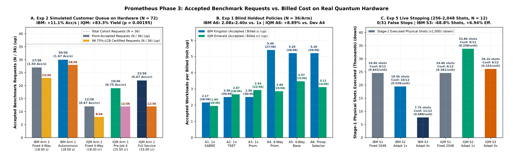
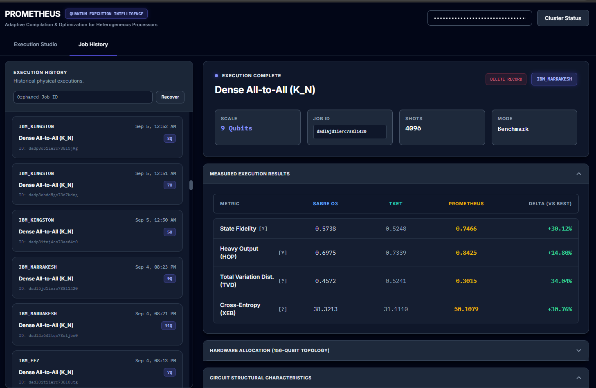

# Detailed Multi-Cloud Campaign Matrix & Stratified 107-Job IBM Heron Corpus Tables

*Companion technical reference to [`README.md`](README.md) in [`prometheus-quantum-overview`](https://github.com/PrometheusDynamicsCanada/prometheus-quantum-overview).*

## 1. Technical Diligence: Executive Summary & Multi-Cloud Benchmark Matrix

> [!NOTE]
> **Metric, UI & Verification Conventions (`python scripts/verify_portfolio_accounting.py`):**
> - **Classical Distribution Overlap (F_B, ↑ higher is better) vs. Squared Hellinger Fidelity (F_H = F_B², ↑ higher is better):** F_B(P_ideal, P_meas) = Σ_x √(P_ideal(x) · P_meas(x)); F_H = F_B². Note that the Studio UI label `"State Fidelity [?]"` displays F_B.
> - **Total Variation Distance (TVD, ↓ lower is better):** 0.5 · Σ_x |P_ideal(x) - P_meas(x)|. **Heavy-Output Probability (HOP, ↑)** and **Linear Cross-Entropy (XEB, ↑)** are reported alongside structural gate and depth metrics.
> - **Chemical Energy Accuracy (`|E_meas - E_ref| <= 25.0 mHa`, ↓ lower error is better):** Evaluated against each molecular configuration's pre-registered active-space `FCI` or `DOCI` reference in both primary and independent confirmation runs.

### Table 1A: Multi-Cloud Benchmark Campaign Summary Across the Quantum Portfolio

| Benchmark Campaign & Repository | Target Processors | Verified Hardware Scope | Reconciled Headline Outcome |
| :--- | :--- | :--- | :--- |
| **[`prometheus-quantum-chemistry`](https://github.com/PrometheusDynamicsCanada/prometheus-quantum-chemistry)** | `ibm_fez` (156Q Heron), IQM Emerald (54Q) | 32 molecular configurations, 172 live QPU jobs (86 IBM + 86 IQM), 4,812 PUBs, 3,756,032 shots | **-54.7% vs. SABRE & -51.8% vs. TKET** charged IBM `s`/confirmed calc on 24 unseen configurations (49/72 at **1.041 s**); **-58.9% vs. SABRE & -61.0% vs. TKET** IQM `cr`/confirmed calc (45/72 at **1.233 cr**); **-52.8% to -68.5% (IBM)** and **-60.0% to -60.7% (IQM)** charged resource per strict success in cold-start `SPSA` (**49/49** early stops confirmed) |
| **[`prometheus-practical-execution-limits`](https://github.com/PrometheusDynamicsCanada/prometheus-practical-execution-limits)** | `ibm_marrakesh`, `ibm_fez` (156Q Heron), IQM Emerald (54Q) | 129 unique logical workloads, 24 live QPU jobs (20 IBM + 4 IQM), 1,648 PUBs, 1,687,552 shots | **10/10 fresh + 5/5 (`+32h`)** strict two-wave `Confirmed Pass` on 15Q dense QFT (`ibm_marrakesh`, **14.27% vs. 0.29%** SABRE exact-answer probability = **48.7x**; **0/10 & 0/5** SABRE/TKET Pass) and **5/5 Pass** at 12Q on `IQM Emerald` (**17.68% vs. 3.00%**); reports all `Stage 5.1` ties (`7/28`), `16Q-17Q`, and `ibm_fez` unresolved/marginal limits |
| **[`prometheus-quantum-execution`](https://github.com/PrometheusDynamicsCanada/prometheus-quantum-execution)** | `ibm_kingston`, `ibm_fez`, `ibm_marrakesh` (156Q), IQM Emerald (54Q), IQM Garnet (20Q) | 308 unseen workloads, 157 provider records (149 bench + 8 aux), 2,509 PUBs, 4,963 evaluations, 2,093,568 shots | **30/36 vs. 27/36 (+11.11%)** accepted IBM requests at identical **18.00 s** charged QPU time; **22/36 vs. 12/36 (+83.33%)** accepted on IQM Emerald (0.8685 vs. 0.8268 F_B, identical 0.6667 Acc/cr); **0/31** false stops in live adaptive shot stopping (**-68.75%** IBM Stage-1 shots) |
| **[`prometheus-quality-gated-packing`](https://github.com/PrometheusDynamicsCanada/prometheus-quality-gated-packing)** | `ibm_fez`, `ibm_kingston` (156Q Heron), IQM Emerald (54Q) | 29 unique provider records (28 completed benchmark jobs + 1 superseded queue dispatch), 121 PUBs, 186,368 shots (96.0 s IBM + 15.75 cr IQM) | **-54.55%** billed IBM `s`/accepted (`8/8` in `5.0 s`, `0.6250 s/acc`) across 8 distinct circuits from 4 families; placement-matched `4-way` **-37.66% `s`/acc** (`-0.0013` mean Delta F_B vs. `1-way`); counterbalanced `ABCCBA` quality-gated `4-way` beat `8-way` near threshold (**1.5000 s vs. 1.6667 s/acc, -10.0%**) |
| **[`prometheus-ibm-parallel-execution`](https://github.com/PrometheusDynamicsCanada/prometheus-ibm-parallel-execution)** | `ibm_fez`, `ibm_marrakesh`, `ibm_kingston` (156Q) | 19 completed jobs (586 physical PUBs, 1,140 evaluations, 655,360 shots, 220.0 s charged time) | **2.85x** qualifying workloads per billed second (**-57.1%** charged QPU time, 3.0 s vs. 7.0 s) on `ibm_marrakesh`; measured isolated-vs.-packed differences **Δ F_B = -0.0012 to +0.0035** across 216 paired controls; TKET simultaneous 8-way packing improves F_B by **+0.0031** over isolated TKET (`p = 0.0117`) |
| **[`prometheus-iqm-execution`](https://github.com/PrometheusDynamicsCanada/prometheus-iqm-execution)** | IQM Emerald (54Q), IQM Garnet (20Q) | 59 completed QPU jobs (1,479 physical circuits/PUBs, 1,935 evaluations, 1,135,616 shots) | **3.00x** qualified results per IQM credit (**3.30x** per active execution second) at 4-way multiplexing (`120/120 ≥ 0.90`); **+3.73%** workload-averaged F_B vs. SABRE K=8 (0.7389 vs. 0.7123, 39/48 wins) & **16/16 (100%)** wins under matched physical placement; **99.0%** loss recovery on Stage 4B held-out suite |
| **[`prometheus-ibm-compiler-benchmarks`](https://github.com/PrometheusDynamicsCanada/prometheus-ibm-compiler-benchmarks)** | `ibm_marrakesh`, `ibm_fez`, `ibm_kingston` (156Q) | 10 packed `SamplerV2` jobs (441 physical circuits, 755,712 shots: 297 in 99 tournaments + 144 pre-committed) | **65/99 (65.7%)** pairwise wins vs. SABRE O3, **89/99 (89.9%)** pairwise wins vs. TKET, and **62/99 (62.6%)** simultaneous 3-way tournament wins across 3Q-13Q sweep & 9Q 15-algorithm matrix; **16/18 (88.9%)** primary metric wins vs. SABRE O3 (15/18 vs. TKET) on pre-committed suite |
| **[`prometheus-ibm-scaling-benchmarks`](https://github.com/PrometheusDynamicsCanada/prometheus-ibm-scaling-benchmarks)** | `ibm_fez`, `ibm_marrakesh`, `ibm_kingston` (156Q) | 17 batch jobs (1,023 physical circuits, 1,047,552 shots, 326.0 s charged time) | **+5.42%** mean F_H (0.6453 vs. 0.6121 SABRE O3; **+3.27%** F_B, 0.7838 vs. 0.7590, **-12.06%** 2Q gates) across 432 Pillar 1A circuits, expanding to **+6.67%** F_H (0.6846 vs. 0.6418) with pre-execution QPU dispatch; **0.5379 vs. 0.3801** polarization (+41.53%) at 101Q Clifford mirrors |
| **[`prometheus-braket-validation`](https://github.com/PrometheusDynamicsCanada/prometheus-braket-validation)** | Rigetti Cepheus-1-108Q (108Q) | 10 `ProgramSet` tasks (450 physical circuits, 460,800 shots across 3 calibration windows) | **+3.91%** 3-window workload-averaged F_B (0.5232 vs. 0.5035 SABRE O3, p_Holm = 0.0112) and **+9.03%** vs. TKET (0.4799, p_Holm = 0.000641), with **-13.36%** fewer 2Q gates and **-23.56%** lower depth; **+6.61%** vs. SABRE O3 (0.5398 vs. 0.5063) in Window 3 post-recalibration |
| **[`prometheus-quantum-and-gpu-benchmarks`](https://github.com/PrometheusDynamicsCanada/prometheus-quantum-and-gpu-benchmarks)** | 3 IBM Heron (156Q), Rigetti (108Q), 2 IQM (20Q/54Q) + Classical NVIDIA H100 | 119 completed 3-way QPU jobs/tasks (357 circuits, 5,084,160 shots) + 150 separate H100 GPU runs | **80/107 (74.8%)** pairwise wins vs. SABRE O3 and **100/107 (93.5%)** vs. TKET on Heron (4Q-23Q); **9/12** fidelity wins and **12/12 (100.0%)** depth & 2Q gate reductions on Braket; separate `72 -> 4` QUBO compression & 5.26 s 1,029-variable H100 schedule |


*Figure 2: Three-panel module breakdown from [`prometheus-quantum-execution`](https://github.com/PrometheusDynamicsCanada/prometheus-quantum-execution): (A) simulated customer queue (`N = 72`), (B) separately billed prospective policy selector (`N = 36/arm`), and (C) sequentially valid live shot stopping (`256-2,048` shots, `0/31` false stops). A simplified two-bar queue summary is also archived at [`assets/fig0_service_two_bar_overview.png`](assets/fig0_service_two_bar_overview.png).*

### Table 1B: Matched 107-Job 3-Way IBM Heron Compiler Corpus - Full Observable & Structural Summary (`321` Circuits, `4,964,352` Physical Shots)

*Source ledger: [`ibm_heron_156q_verified_benchmarks.json`](https://github.com/PrometheusDynamicsCanada/prometheus-quantum-and-gpu-benchmarks/blob/main/ibm_heron_156q_verified_benchmarks.json) (`N = 107` completed 3-way QPU jobs across `ibm_fez` [`44`], `ibm_kingston` [`33`], and `ibm_marrakesh` [`30`]; `4Q-23Q` logical widths; `69` Dense All-to-All `K_N`, `13` 3-Regular MaxCut QAOA, `13` QFT, `11` Quantum Volume, and `1` Star-Graph stress test; all `107` Job IDs verified in [`PORTFOLIO_ACCOUNTING_LEDGER.json`](PORTFOLIO_ACCOUNTING_LEDGER.json) and `scripts/verify_portfolio_accounting.py`). Kept strictly separate from whole-portfolio job/shot totals.*

| Metric & Direction | Prometheus *(mean / median)* | Qiskit SABRE O3 *(mean / median)* | Quantinuum TKET *(mean / median)* | Mean % Delta vs. SABRE O3 | Mean % Delta vs. TKET | Pairwise & 3-Way Wins (`N = 107`) |
| :--- | ---: | ---: | ---: | ---: | ---: | ---: |
| **Distribution Overlap F_B (↑)** *(Studio UI: "State Fidelity")* | **0.3780** / **0.2076** | 0.3494 / 0.1645 | 0.2971 / 0.0732 | **+8.17%** *(+0.0286)* | **+27.23%** *(+0.0809)* | **80/107** vs. SABRE · **100/107** vs. TKET · **77/107** 3-way |
| **Heavy-Output Probability HOP (↑)** | **53.70%** / **60.81%** | 52.13% / 57.32% | 50.23% / 56.79% | **+3.02%** *(+1.58 pp)* | **+6.91%** *(+3.47 pp)* | **58/107** vs. SABRE · **65/107** vs. TKET · **48/107** 3-way |
| **Total Variation Distance TVD (↓)** | **0.6286** / **0.7501** | 0.6565 / 0.8088 | 0.7184 / 0.8851 | **-4.24%** *(-0.0279)* | **-12.50%** *(-0.0898)* | **81/107** vs. SABRE · **100/107** vs. TKET · **79/107** 3-way |
| **Linear Cross-Entropy XEB (↑)** | **290.29** / **55.70** | 233.51 / 35.04 | 109.40 / 10.20 | **+24.31%** *(+56.78)* | **+165.34%** *(+180.89)* | **70/107** vs. SABRE · **87/107** vs. TKET · **65/107** 3-way |
| **Observed Shannon Entropy H_obs, bits (↓ toward Ideal 10.46 / 10.40)** | **11.67** / **12.94** | 11.79 / 13.17 | 11.92 / 13.53 | **-0.99%** *(-0.12 bits)* | **-2.09%** *(-0.25 bits)* | **73/107** vs. SABRE · **83/107** vs. TKET · **66/107** 3-way |
| **Native Two-Qubit CZ Gates (↓)** | **290.86** / **317.00** | 338.84 / 351.00 | 532.50 / 559.00 | **-14.16%** *(-47.98)* | **-45.38%** *(-241.64)* | **83/107** vs. SABRE · **93/107** vs. TKET · **80/107** 3-way |
| **Compiled Circuit Depth (↓)** | **256.64** / **266.00** | 321.19 / 342.00 | 464.09 / 478.00 | **-20.10%** *(-64.55)* | **-44.70%** *(-207.46)* | **79/107** vs. SABRE · **107/107** vs. TKET · **79/107** 3-way |

### Table 1B-2: Stratified 107-Job IBM Heron Corpus Breakdown by Circuit Family (`*(mean / median)*`, Zero Placeholders)

*Why stratify by circuit family: Unweighted corpus-wide relative means (`Table 1B`) weight each job by its baseline observable magnitude rather than routing complexity. Sparse `4Q-12Q` 3-regular MaxCut QAOA (`0.9234` SABRE baseline F_B) and contiguous-chain Quantum Volume (`0.6602` SABRE baseline F_B, `0` SWAP routing delta) account for `51.6%` of SABRE's total F_B sum across only `24/107` jobs, diluting the `+26.31%` mean (`+50.00%` median) vs. SABRE and `+100.45%` (`2.00x` mean, `4.50x` median) vs. TKET overlap gains on `69` non-local Dense All-to-All (`K_N`) jobs. Note that `QFT` (`N = 13`: `6` at `8Q-20Q` + `7` at `21Q-22Q`) prepares a flat uniform ideal distribution (`2^(-n)`), so `HOP = 0.00%` identically across all compilers.*

| Circuit Family (`N`, Widths, Shots) | Distribution Overlap F_B (↑) *(mean / median)*: Prom · SABRE · TKET | Heavy-Output Prob. HOP (↑) *(mean / median)*: Prom · SABRE · TKET | Total Variation Dist. TVD (↓) *(mean / median)*: Prom · SABRE · TKET | Linear XEB (↑) *(mean / median)*: Prom · SABRE · TKET | Observed Entropy H_obs, bits (↓) *(mean / median)*: Prom · SABRE · TKET | Native 2Q CZ Gates (↓) *(mean / median)*: Prom · SABRE · TKET | Compiled Depth (↓) *(mean / median)*: Prom · SABRE · TKET |
| :--- | ---: | ---: | ---: | ---: | ---: | ---: | ---: |
| **Dense All-to-All `K_N`** (`N = 69`, `7Q-23Q`, `3,317,760` shots) | **0.2186 / 0.1444** · 0.1731 / 0.0963 (**+26.31%**) · 0.1091 / 0.0321 (**+100.45%**) | **63.55% / 61.98%** · 61.08% / 59.19% (**+2.47 pp**) · 58.54% / 58.72% (**+5.01 pp**) | **0.7573 / 0.8089** · 0.8035 / 0.8571 (**-5.74%**) · 0.8761 / 0.9440 (**-13.56%**) | **316.09 / 185.67** · 228.74 / 80.28 (**+38.19%**) · 40.10 / 22.92 (**+688.35%**) | **12.54 / 13.37** · 12.72 / 13.53 (**-1.40%**) · 12.94 / 13.79 (**-3.11%**) | **351.96 / 358.00** · 410.38 / 436.00 (**-14.24%**) · 667.87 / 717.00 (**-47.30%**) | **279.78 / 295.00** · 361.36 / 370.00 (**-22.58%**) · 505.26 / 501.00 (**-44.63%**) |
| **Quantum Fourier Transform `QFT`** (`N = 13`, `8Q-22Q`, `638,976` shots) | 0.4172 / **0.0078** · **0.4337** / **0.0078** (-3.79%, `9/13` wins) · 0.4081 / 0.0077 (**+2.24%**) | **0.00% / 0.00%** · **0.00% / 0.00%** (0.00 pp) · **0.00% / 0.00%** (0.00 pp) | 0.6251 / **0.9866** · **0.6095** / 0.9888 (+2.55%) · 0.6592 / 0.9906 (**-5.17%**) | **687.48 / 5.93** · 697.81 / 5.79 (-1.48%, `9/13` wins) · 667.61 / 5.56 (**+2.98%**) | **11.96 / 13.48** · 12.01 / 13.50 (**-0.46%**) · 12.02 / 13.53 (**-0.55%**) | **436.85 / 687.00** · 518.15 / 728.00 (**-15.69%**, `13/13`) · 716.77 / 1077.00 (**-39.05%**, `13/13`) | **474.62 / 645.00** · 581.46 / 774.00 (**-18.38%**) · 922.92 / 1321.00 (**-48.57%**, `13/13`) |
| **QAOA MaxCut `3-Regular`** (`N = 13`, `4Q-12Q`, `638,976` shots) | **0.9325 / 0.9121** · 0.9234 / 0.9072 (**+0.98%**) · 0.8792 / 0.8835 (**+6.06%**) | 21.14% / **0.00%** · **21.39%** / **0.00%** (-0.25 pp) · 21.06% / **0.00%** (**+0.08 pp**) | **0.1716 / 0.2111** · 0.1798 / 0.2138 (**-4.55%**) · 0.2383 / 0.2371 (**-27.98%**) | 0.2605 / **0.0000** · **0.2675** / **0.0000** (-2.63%) · 0.2531 / **0.0000** (**+2.92%**) | 8.68 / 11.75 · 8.65 / 11.60 (+0.39%) · **8.55 / 11.55** (+1.51%) | **44.92 / 51.00** · 48.46 / **51.00** (**-7.30%**) · 75.77 / 108.00 (**-40.71%**) | 110.92 / 115.00 · **102.38 / 106.00** (+8.34%) · 163.69 / 212.00 (**-32.24%**) |
| **Quantum Volume `Random SU4`** (`N = 11`, `8Q-21Q`, `319,488` shots) | **0.6608 / 0.9092** · 0.6602 / 0.9087 (**+0.10%**) · 0.6365 / 0.9021 (**+3.83%**) | **93.80% / 94.58%** · 93.70% / 94.02% (**+0.11 pp**) · 91.71% / 93.48% (**+2.10 pp**) | 0.3672 / 0.1883 · **0.3665 / 0.1850** (+0.18%) · 0.4028 / 0.1994 (**-8.85%**) | 27.74 / **3.86** · **27.79** / 3.80 (-0.16%) · 21.02 / 3.82 (**+32.00%**) | **9.98** / 8.45 · 9.99 / **8.43** (**-0.08%**) · 10.09 / 8.56 (**-1.11%**) | **49.82 / 36.00** · **49.82 / 36.00** (0.00%) · **49.82 / 36.00** (0.00%) | **44.00 / 44.00** · **44.00 / 44.00** (0.00%) · 52.00 / 52.00 (**-15.38%**) |
| **Star Graph `Topology Stress`** (`N = 1`, `15Q`, `49,152` shots) | **0.5453 / 0.5453** · 0.5424 / 0.5424 (**+0.53%**) · 0.5283 / 0.5283 (**+3.22%**) | **54.58% / 54.58%** · 54.29% / 54.29% (**+0.29 pp**) · 53.14% / 53.14% (**+1.45 pp**) | **0.4648 / 0.4648** · 0.4673 / 0.4673 (**-0.54%**) · 0.4792 / 0.4792 (**-3.02%**) | **1.1604 / 1.1604** · 1.1398 / 1.1398 (**+1.81%**) · 1.0731 / 1.0731 (**+8.14%**) | **13.52 / 13.52** · 13.52 / 13.52 (**-0.04%**) · 13.56 / 13.56 (**-0.31%**) | **26.00 / 26.00** · **26.00 / 26.00** (0.00%) · 44.00 / 44.00 (**-40.91%**) | **59.00 / 59.00** · **59.00 / 59.00** (0.00%) · 97.00 / 97.00 (**-39.18%**) |

### Table 1C: Representative Single-Job 3-Way Studio Execution - 9-Qubit Dense All-to-All (K_9) on `ibm_marrakesh` (Job ID: `dadl5jd1ierc738l1420`, 4,096 Shots/Compiler)

| Metric & Direction | Qiskit SABRE O3 | Quantinuum TKET | Prometheus | Prometheus vs. Best Baseline |
| :--- | ---: | ---: | ---: | ---: |
| **Compiled Circuit Depth (↓)** | 145 | 165 | **109** | **-24.83%** |
| **Native Two-Qubit CZ Gates (↓)** | 90 | 123 | **74** | **-17.78%** |
| **Distribution Fidelity F_B (↑)** *(Studio UI: "State Fidelity")* | 0.5738 | 0.5248 | **0.7466** | **+30.12%** |
| **Heavy-Output Probability HOP (↑)** | 0.6975 | 0.7339 | **0.8425** | **+14.80%** |
| **Total Variation Distance TVD (↓)** | 0.4572 | 0.5241 | **0.3015** | **-34.04%** |
| **Linear Cross-Entropy XEB (↑)** | 38.3213 | 31.1110 | **50.1079** | **+30.76%** |

[](screenshots/07-qv-execution-result.png)
*Figure 3: Prometheus Execution Studio 3-way compiler comparison (Qiskit SABRE O3 vs. Quantinuum TKET vs. Prometheus) on 9-qubit Dense All-to-All (`K_9`) on `ibm_marrakesh` (Job ID `dadl5jd1ierc738l1420`; overlap F_B: `0.5738` SABRE O3 / `0.5248` TKET / **`0.7466` Prometheus [`+30.12%`]**).*

---

## 2. Technical Architecture & Verification Guide

```text
Application Workload / Molecular Hamiltonian / OpenQASM 2.0-3.0 Circuit Queue
        |
        +---> Prometheus Hardware-Aware Compiler
        +---> Qiskit SABRE O3 Baseline
        +---> Quantinuum TKET Baseline
                    |
                    v
   Physical Candidate Verification & Live Calibration Scoring
                    |
                    v
   Pre-Execution Candidate, Target-QPU & Buffered Packing (frozen spacing policy) Selection
                    |
                    v
   Adaptive Cloud Execution (IBM SamplerV2 / IQM Resonance / AWS Braket ProgramSet)
                    |
                    v
   Reference-Free Early Stopping, Standalone Confirmation & Offline Audit
```

- **[`PORTFOLIO_ACCOUNTING_LEDGER.json`](PORTFOLIO_ACCOUNTING_LEDGER.json)** & **[`scripts/verify_portfolio_accounting.py`](scripts/verify_portfolio_accounting.py)** - Single authoritative cross-repository accounting and Job-ID deduplication ledger (`630` unique provider Job IDs / Task ARNs across `13` quantum repositories: `621` completed benchmark jobs + `9` auxiliary warm-up/troubleshooting/superseded records, `0` cross-campaign duplicates).
- **[`PUBLIC_DISCLOSURE.md`](PUBLIC_DISCLOSURE.md)** - Five verification tiers across the portfolio, withheld proprietary internals, and clean single-commit release provenance.
- **[`SCREENSHOT_GALLERY.md`](SCREENSHOT_GALLERY.md)**, **[`results/RESULTS.md`](results/RESULTS.md)**, & **[`demonstrations/DEMONSTRATIONS.md`](demonstrations/DEMONSTRATIONS.md)** - Complete 18-screenshot visual walkthrough and Job ID index of Prometheus Execution Studio.
- **[`ARCHITECTURE.md`](ARCHITECTURE.md)** & **[`PROJECT_DIRECTION.md`](PROJECT_DIRECTION.md)** - Multi-compiler candidate evaluation, buffered spatial multiplexing, closed-loop chemistry, and cross-paradigm roadmap.

---
