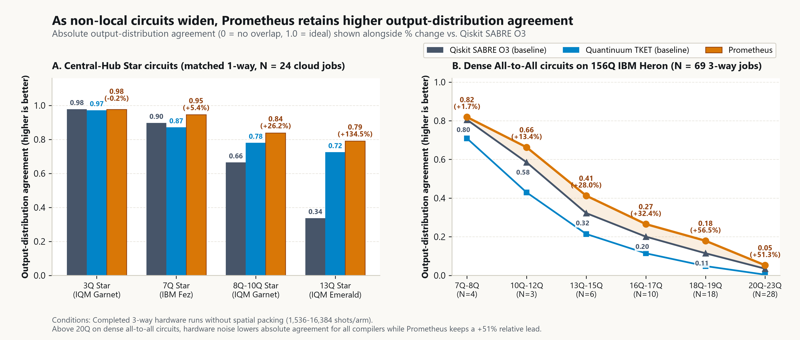
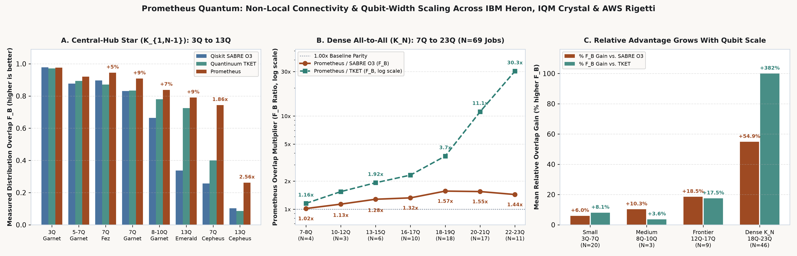
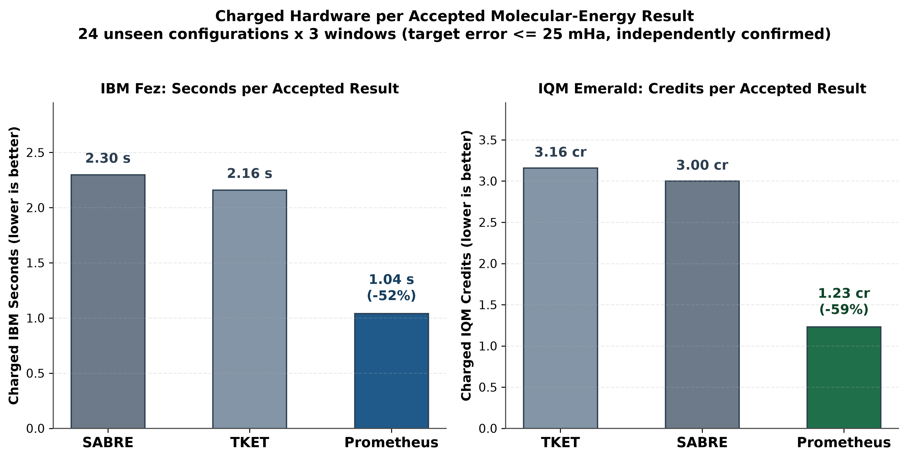

# Prometheus Quantum: Verified Hardware Overview

**Prometheus is execution software that helps teams run gate-based quantum circuits more accurately and at lower billed hardware cost across IBM, IQM, and Rigetti cloud processors (alongside a separate neutral-atom analog study on 256-atom QuEra Aquila).**

**[See the Product](https://prometheusdynamics.ca/#product-walkthrough) · [Explore Case Studies](https://prometheusdynamics.ca/evidence/) · [Discuss a Pilot or Investment](https://prometheusdynamics.ca/#pilot-and-investors)**

## Introduction

- **The question:** Can software improve result quality and lower provider-billed hardware spend on today's cloud quantum processors without changing a team's underlying algorithm?
- **The test:** Across `14` public quantum repositories (`829` unique cloud records: `819` completed benchmark jobs/tasks + `10` auxiliary records, `14,676` PUBs/schedules, `22.40M` physical shots, `0` duplicate IDs), we compared Prometheus against Qiskit SABRE O3 and Quantinuum TKET on `6` superconducting gate-model processors (`IBM Fez`, `Kingston`, `Marrakesh`, `IQM Emerald`, `IQM Garnet`, `Rigetti Cepheus-1-108Q`), plus `11-13`-atom instances on the `256`-atom `QuEra Aquila` neutral-atom analog device.
- **The finding:** Prometheus cut billed QPU resources per confirmed molecular-energy calculation by **`52%` to `69%`**, delivered up to **`3.00x` qualifying workloads per billed unit** via simultaneous multi-circuit execution, and passed **`10/10` fresh + `5/5` (`+32h`)** `15`-qubit dense QFT checks where both baselines passed `0`.
- **The significance:** Teams can stretch finite IBM second, IQM credit, and AWS Braket budgets further while keeping wider, heavily connected circuits above quality thresholds.
- **The boundary:** On small, lightly connected circuits (`3Q-6Q` local chains), standard compilers perform near parity; baseline wins (`27/107` on the historical IBM corpus, `5/32` in the multi-cloud atlas) and unresolved `16Q-17Q` limits are published openly.
- **The evidence:** Simplified opening chart and compact summary tables below, backed by [`PORTFOLIO_ACCOUNTING_LEDGER.json`](PORTFOLIO_ACCOUNTING_LEDGER.json), [`DETAILED_TECHNICAL_REPORT.md`](DETAILED_TECHNICAL_REPORT.md), and offline verification scripts.

### What Changed (`2026-11-23` Release `v2026.11.23`)
- Added Repository `#14` ([`prometheus-circuit-complexity-atlas`](https://github.com/PrometheusDynamicsCanada/prometheus-circuit-complexity-atlas): `187` new cloud records, `32` 3-way groups, `1.41M` shots across `6` superconducting QPUs, expanding reconciled portfolio totals from `642 -> 829` unique records and `20.99M -> 22.40M` shots).

*Opening summary: Absolute output-distribution agreement (`0` to `1.0`) and `%` change vs. Qiskit SABRE O3 across `3Q-13Q` Central-Hub Star (`N = 24` cloud jobs) and `7Q-23Q` Dense All-to-All circuits (`N = 69` completed 3-way IBM Heron jobs).*

---

## 1. Six Practical Questions & Primary Case Studies

| Question | Principal Measured Result | Case-Study Repository |
| :--- | :--- | :--- |
| **Can I spend less per chemistry result?** | **`52%-69%` fewer** billed IBM seconds & IQM credits per confirmed `<= 25 mHa` energy (`172` jobs) | [`prometheus-quantum-chemistry`](https://github.com/PrometheusDynamicsCanada/prometheus-quantum-chemistry) |
| **Can I get more work per processor unit?** | **`3.00x`** qualifying results/IQM credit, **`2.85x`/IBM s**, and **`-54.55%` IBM s/accepted** (4 families) | [`prometheus-quality-gated-packing`](https://github.com/PrometheusDynamicsCanada/prometheus-quality-gated-packing) · [`prometheus-iqm-execution`](https://github.com/PrometheusDynamicsCanada/prometheus-iqm-execution) |
| **Can demanding circuits pass quality checks?** | **`10/10` fresh + `5/5` (`+32h`)** `15Q` IBM QFT passes & **`5/5`** `12Q` IQM passes (`0` baseline passes) | [`prometheus-practical-execution-limits`](https://github.com/PrometheusDynamicsCanada/prometheus-practical-execution-limits) |
| **How does quality change as circuits widen?** | **`25/30` (`83.3%`)** completed 3-way wins (`27/32` incl. `2` pre-flight baseline halts); **`+134.5%`** on `13Q` Star | [`prometheus-circuit-complexity-atlas`](https://github.com/PrometheusDynamicsCanada/prometheus-circuit-complexity-atlas) |
| **How does automated queue & stopping behave?** | **`30/36` vs. `27/36`** accepted at `18 s` (IBM), **`22/36` vs. `12/36`** (IQM), **`0/31`** false early stops | [`prometheus-quantum-execution`](https://github.com/PrometheusDynamicsCanada/prometheus-quantum-execution) |
| **Does it extend to Rigetti & neutral atoms?** | **`+6.61%`** post-recal on `108Q` Rigetti + **`+18.11%`** `12`-atom optimum yield (`p = 0.0042`) on `256`-atom QuEra Aquila | [`prometheus-braket-validation`](https://github.com/PrometheusDynamicsCanada/prometheus-braket-validation) |

## 2. Executive Compiler Summary (`N = 107` Completed 3-Way IBM Heron Jobs, `321` Circuits, `4,964,352` Shots)

*Hardware IDs:* `dbajlrhgv2cc73e6vuj0` .. `daf9p65nj4cs73ag3f20` across `ibm_fez`, `ibm_kingston`, and `ibm_marrakesh` (`4Q-23Q`, `*(mean)*` values shown; `*(median)*` values and `69`-job Dense `K_N` breakdown are in the expandable section below).

| Compiler (`N = 107` Completed 3-Way Jobs) | Output-Distribution Agreement $F_B$ `(↑)` | Squared Hellinger $F_H$ `(↑)` | `HOP` `(↑)` | `TVD` `(↓)` | `XEB` `(↑)` | Entropy `(↓)` | `2Q` `CZ` / Depth `(↓)` | Mean $F_B$ Delta |
| :--- | :---: | :---: | :---: | :---: | :---: | :---: | :---: | :---: |
| **Qiskit SABRE O3** | `0.3494` | `0.2624` | `52.13%` | `0.6565` | `233.5` | `11.79` | `338.8` / `321.2` | Best Baseline (`27/107` wins) |
| **Quantinuum TKET** | `0.2971` | `0.2277` | `50.23%` | `0.7184` | `109.4` | `11.92` | `532.5` / `464.1` | `-14.97%` vs. SABRE |
| **Prometheus** | **`0.3780`** | **`0.2742`** | **`53.70%`** | **`0.6286`** | **`290.3`** | **`11.67`** | **`290.9` / `256.6`** | **`+8.17%` vs. S (`+26.31%` on `K_N`)** |

*Metric Key:* Output-distribution agreement is Classical Bhattacharyya Overlap $F_B = \sum_x \sqrt{P_{\text{ideal}}(x)P_{\text{meas}}(x)}$ (which Studio UI screenshots label `"State Fidelity"`, distinct from $4^n$ quantum state tomography); Squared Hellinger Fidelity is $F_H = F_B^2$. `(↑)` higher is better, `(↓)` lower is better; **bold** marks row winners.

---

## Inspect the Evidence & Reproduce Supported Checks Offline

- **Command:** `python scripts/verify_portfolio_accounting.py`
- **Dependencies & measured runtime:** Python 3 standard library only (`0` cloud credentials, **`~0.06 s`** measured runtime; verifies `829/829` unique IDs, `0` cross-repo duplicates, `107`-job raw corpus arithmetic, and `38/38` SHA-256 digests).
- **Start a pilot or investor briefing:** [william@prometheusdynamics.ca](mailto:william@prometheusdynamics.ca) | [prometheusdynamics.ca](https://prometheusdynamics.ca)

---

## Deep-Dive Tables, Scientific Figures & All 14 Quantum Repositories

<strong>1. Complete Directory of All 14 Quantum Repositories (829 Unique Cloud Records · 22.40M Shots) - Click to expand</strong>

Global portfolio totals are maintained in [`PORTFOLIO_ACCOUNTING_LEDGER.json`](PORTFOLIO_ACCOUNTING_LEDGER.json) (`829` unique provider records = `819` completed benchmark jobs/tasks + `10` auxiliary records across `475` IBM Quantum, `306` IQM Resonance, and `48` AWS Braket tasks [`36` superconducting `Rigetti/IQM` + `12` `256`-atom `QuEra Aquila` analog `AHS` tasks]; `14,676` PUBs/schedules; `22,398,648` physical shots; `0` duplicates):

| # | Repository | Incremental Scope (`Jobs`, `PUBs`, `Shots`) | Focus, Dependencies & Measured Verifier Runtime |
| :---: | :--- | :---: | :--- |
| **1** | **[`prometheus-quantum-overview`](https://github.com/PrometheusDynamicsCanada/prometheus-quantum-overview)** | Hub (`0` incremental) | Portfolio hub, [`ARCHITECTURE.md`](ARCHITECTURE.md), & 829-ID deduplication (`stdlib` · **`0.06 s`**) |
| **2** | **[`prometheus-quantum-chemistry`](https://github.com/PrometheusDynamicsCanada/prometheus-quantum-chemistry)** | `172` jobs · `4,812` PUBs · `3,756,032` shots | `-52%` to `-69%` QPU cost per confirmed `<= 25 mHa` calc (`numpy, scipy` · **`0.80 s`**) |
| **3** | **[`prometheus-practical-execution-limits`](https://github.com/PrometheusDynamicsCanada/prometheus-practical-execution-limits)** | `24` jobs · `1,648` PUBs · `1,687,552` shots | `10/10` fresh + `5/5` (`+32h`) `15Q` QFT passes + boundaries (`numpy` · **`80.6 s`**) |
| **4** | **[`prometheus-quantum-execution`](https://github.com/PrometheusDynamicsCanada/prometheus-quantum-execution)** | `157` rec (`149` bench) · `2,509` PUBs · `2,093,568` shots | Queue management & sequential stopping (`0/31` false stops) (`numpy, scipy` · **`0.75 s`**) |
| **5** | **[`prometheus-ibm-parallel-execution`](https://github.com/PrometheusDynamicsCanada/prometheus-ibm-parallel-execution)** | `19` jobs · `586` PUBs · `655,360` shots | `2.85x` workloads/billed IBM second (`8-way` simultaneous) (`numpy` · **`0.33 s`**) |
| **6** | **[`prometheus-iqm-execution`](https://github.com/PrometheusDynamicsCanada/prometheus-iqm-execution)** | `59` jobs · `1,479` PUBs · `1,135,616` shots | `3.00x`/IQM credit `4-way` parallel & `+3.73%` dense compilation (`numpy, scipy` · **`3.25 s`**) |
| **7** | **[`prometheus-ibm-compiler-benchmarks`](https://github.com/PrometheusDynamicsCanada/prometheus-ibm-compiler-benchmarks)** | `10` jobs · `441` circs · `755,712` shots | Same-window 3-way IBM tournaments (`65/99` vs. S, `89/99` vs. T) (`stdlib/numpy` · **`0.04 s`**) |
| **8** | **[`prometheus-ibm-scaling-benchmarks`](https://github.com/PrometheusDynamicsCanada/prometheus-ibm-scaling-benchmarks)** | `17` jobs · `1,023` circs · `1,047,552` shots | `4Q-17Q` 3-QPU repeat (`453`-seed SABRE control) + `8Q-101Q` mirrors (`numpy` · **`0.26 s`**) |
| **9** | **[`prometheus-braket-validation`](https://github.com/PrometheusDynamicsCanada/prometheus-braket-validation)** | `22` tasks · `462` runs · `463,800` shots | `108Q` Rigetti 3-window + `256`-atom QuEra Aquila (`11-13` atoms) (`numpy, scipy` · **`1.34 s`**) |
| **10** | **[`prometheus-processor-selection`](https://github.com/PrometheusDynamicsCanada/prometheus-processor-selection)** | Shared (`33` job ZIPs in #12 + `4` in #7) | `2.75x` observed spread across sibling `156Q` IBM Heron chips (`stdlib` · **`0.04 s`**) |
| **11** | **[`prometheus-noise-aware-routing`](https://github.com/PrometheusDynamicsCanada/prometheus-noise-aware-routing)** | `14` jobs · `774` PUBs · `4,125,440` shots | Exploratory `30/40` routing wins vs. `10/40` SWAP losses (`stdlib/numpy` · **`0.04 s`**) |
| **12** | **[`prometheus-quantum-and-gpu-benchmarks`](https://github.com/PrometheusDynamicsCanada/prometheus-quantum-and-gpu-benchmarks)** | `119` QPU jobs · `357` circs · `5,084,160` shots | `107` IBM + `12` Braket QPU jobs + separate `150`-run H100 study (`stdlib` · **`0.04 s`**) |
| **13** | **[`prometheus-quality-gated-packing`](https://github.com/PrometheusDynamicsCanada/prometheus-quality-gated-packing)** | `29` rec (`28` bench) · `121` PUBs · `186,368` shots | `-54.55%` IBM s/acc (4 families) & `ABCCBA` `4-way` vs. `8-way` (`numpy` · **`0.15 s`**) |
| **14** | **[`prometheus-circuit-complexity-atlas`](https://github.com/PrometheusDynamicsCanada/prometheus-circuit-complexity-atlas)** | `187` rec (`186` bench) · `464` PUBs · `1,407,488` shots | `3Q-17Q` Star-Hub, Chemistry & Simultaneous 5-QPU Matrix (`numpy, qiskit` · **`1.19 s`**) |

*(Adjacent non-quantum repositories: [`argus-server-protection`](https://github.com/PrometheusDynamicsCanada/argus-server-protection) [`stdlib` · `0.06 s`] and [`Hyperion-fusion-telemetry`](https://github.com/PrometheusDynamicsCanada/Hyperion-fusion-telemetry) [`numpy, pandas` · `0.45 s`].)*

<strong>2. Full Scientific Figures, Dense All-to-All K_N Mean/Median Table (N = 69) & Technical Mechanism Notes - Click to expand</strong>

### Dense All-to-All `K_N` Subset (`N = 69` Completed 3-Way IBM Heron Jobs, `7Q-23Q`, `207` Circuits, `3,317,760` Shots)

| Compiler (`N = 69` `K_N` Jobs) | $F_B$ `*(mean / med)*` `(↑)` | $F_H$ `*(mean / med)*` `(↑)` | `HOP` `*(mean / med)*` `(↑)` | `TVD` `*(mean / med)*` `(↓)` | `XEB` `*(mean / med)*` `(↑)` | Entropy `*(mean / med)*` `(↓)` | `2Q` `CZ` / Depth `*(mean)*` `(↓)` | Pairwise Wins |
| :--- | :---: | :---: | :---: | :---: | :---: | :---: | :---: | :---: |
| **Qiskit SABRE O3** | `0.1731` / `0.0963` | `0.0745` / `0.0093` | `61.08%` / `59.19%` | `0.8035` / `0.8571` | `228.7` / `80.3` | `12.72` / `13.53` | `410.4` / `361.4` | `12 / 69` vs. Prom |
| **Quantinuum TKET** | `0.1091` / `0.0321` | `0.0466` / `0.0010` | `58.54%` / `58.72%` | `0.8761` / `0.9440` | `40.1` / `22.9` | `12.94` / `13.79` | `667.9` / `505.3` | `1 / 69` vs. Prom |
| **Prometheus** | **`0.2186` / `0.1444`** | **`0.0950` / `0.0208`** | **`63.55%` / `61.98%`** | **`0.7573` / `0.8089`** | **`316.1` / `185.7`** | **`12.54` / `13.37`** | **`352.0` / `279.8`** | **`+26.31%` mean (`+50.0%` med)** |

*(Full `N = 107` pooled medians: $F_B$ `0.2076` Prom vs. `0.1645` SABRE / `0.0732` TKET; $F_H$ `0.0431` vs. `0.0271` / `0.0054`; `HOP` `60.81%` vs. `57.32%` / `56.79%`; `TVD` `0.7501` vs. `0.8088` / `0.8851`; `XEB` `55.70` vs. `35.04` / `10.20`; Entropy `12.94` vs. `13.17` / `13.53`; `CZ` `317.0` vs. `351.0` / `559.0`; Depth `266.0` vs. `342.0` / `478.0`. Supporting docs: [`DETAILED_TECHNICAL_REPORT.md`](DETAILED_TECHNICAL_REPORT.md) · [`PUBLIC_DISCLOSURE.md`](PUBLIC_DISCLOSURE.md) · [`ARCHITECTURE.md`](ARCHITECTURE.md) · [`SCREENSHOT_GALLERY.md`](SCREENSHOT_GALLERY.md).)*

